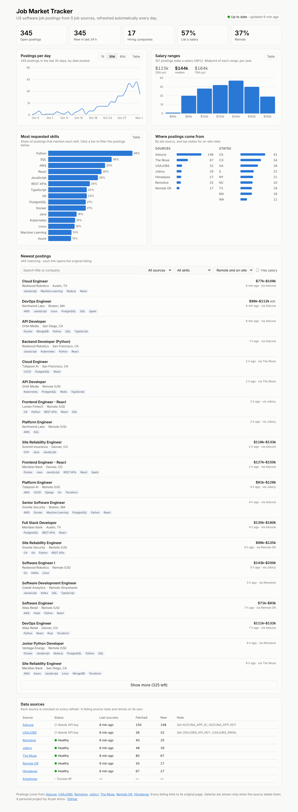

# Job Market Tracker

Live US software job postings, pulled daily from several job APIs, stored in
PostgreSQL and shown on a dashboard: postings per day, most requested skills,
salary ranges and the newest postings.

**Live:** _add your Vercel link_ · **API:** _add your Render link_/health



## How it works
* A Python refresh job runs daily on **GitHub Actions** and pulls from up to eight
  sources: Adzuna, USAJOBS, Remotive, Jobicy, The Muse, Remote OK, Himalayas, Arbeitnow.
* Sources without keys run out of the box; keyed ones switch on when their secrets exist.
* Each source runs in isolation with retries, a daily request budget and an automatic
  cooldown after repeated failures, so one broken API never stops the refresh.
* Postings are cleaned (HTML, locations, salaries normalized to yearly USD), deduplicated
  across sources, tagged with about 36 skills, and stored in **PostgreSQL (Neon)**.
* A **Flask** API serves stats from the database; a **React + Vite + Recharts**
  dashboard shows them. Visitors never trigger a job-API call.

## Run it locally
```bash
cd backend
python -m venv .venv && source .venv/bin/activate
pip install -r requirements-dev.txt
python -m scripts.refresh --demo     # offline sample data (or drop --demo for live APIs)
python wsgi.py                       # API on :5000

cd ../frontend
npm install && npm run dev           # dashboard on :5173
```

Tests: `cd backend && pytest -q` (all job APIs mocked).

Configuration (keywords, skills, sources, budgets): `backend/tracker.toml`.

**Full step-by-step build and deploy guide: [BUILD_GUIDE.md](BUILD_GUIDE.md).**

## Data sources
Postings belong to their sources; every listing links to the original page and each
source is credited on the dashboard. Jobs by [Adzuna](https://www.adzuna.com),
[USAJOBS](https://www.usajobs.gov), [Remotive](https://remotive.com),
[Jobicy](https://jobicy.com), [The Muse](https://www.themuse.com),
[Remote OK](https://remoteok.com) and [Himalayas](https://himalayas.app).

A personal project by Aryan Arora.
